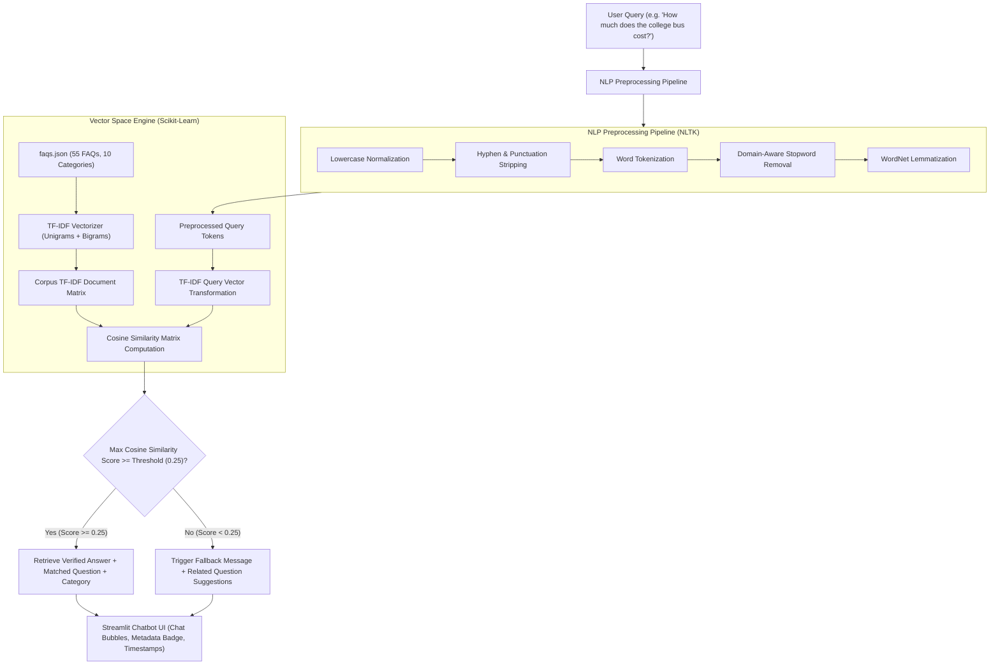

# 🎓 Apex Institute FAQ Chatbot — CodeAlpha AI Internship (Project 1)

[](https://www.python.org/)
[](https://streamlit.io/)
[](https://scikit-learn.org/)
[](https://www.nltk.org/)
[](LICENSE)
[]()

A complete, production-grade Natural Language Processing (NLP) FAQ Chatbot for a university campus environment, built using **Python**, **NLTK**, **Scikit-learn (TF-IDF & Cosine Similarity)**, and an interactive **Streamlit** user interface.

Developed as **Project 1** for the **CodeAlpha Artificial Intelligence Internship**.

> [!NOTE]
> **Fictional Institution Notice:** All college data, course specifics, fees, and contact details for *Apex Institute of Technology (AIT)* are entirely fictional and designed exclusively for educational, development, and portfolio demonstration purposes.

---

## 📑 Table of Contents
1. [Project Overview](#-project-overview)
2. [Key Features](#-key-features)
3. [System Architecture & NLP Pipeline](#-system-architecture--nlp-pipeline)
4. [Dataset Details (`faqs.json`)](#-dataset-details-faqsjson)
5. [Mathematical Formulation: TF-IDF & Cosine Similarity](#-mathematical-formulation-tf-idf--cosine-similarity)
6. [Project Structure](#-project-structure)
7. [Installation & Setup](#-installation--setup)
8. [Running the Application](#-running-the-application)
9. [Running Automated Tests](#-running-automated-tests)
10. [Beginner's Guide & Intuition](#-beginners-guide--intuition)
11. [Two-Minute Video Demonstration Script](#-two-minute-video-demonstration-script)
12. [Resume-Ready Project Description](#-resume-ready-project-description)

---

## 🌟 Project Overview

The **Apex Institute FAQ Chatbot** delivers instant, 24/7 intelligent assistance to current and prospective students, parents, and visitors. Instead of relying on rigid keyword lookups or complex, unpredictable LLMs that may hallucinate inaccurate college policies, this chatbot employs a **deterministic vector space NLP model** combining **Term Frequency-Inverse Document Frequency (TF-IDF)** with **Cosine Similarity**.

### Why TF-IDF and Cosine Similarity?
- **Zero Hallucination:** Answers are strictly grounded in verified institutional FAQs.
- **Fast & Deterministic:** Instant vector computation (< 5 ms latency) without requiring cloud API keys or external model hosting.
- **Explainable & Safe:** Queries below a defined similarity threshold trigger an informative fallback message with relevant suggestions rather than guessing.

---

## ✨ Key Features

- **💬 Modern Streamlit Chat Interface:** Complete with styled user and assistant chat bubbles, responsive avatars, and timestamps.
- **📂 Multi-Category Knowledge Base:** 55 comprehensive FAQs spanning 10 academic and campus categories.
- **🎯 Dual-Index Semantic Matching:** Matches user queries against both primary question vectors and enriched keyword vectors for optimal precision and recall.
- **🛡️ Tunable Fallback Threshold:** Dynamic similarity cutoff slider (default `0.25`) prevents ungrounded responses.
- **💡 Quick-Action Suggestion Chips:** Clickable question pills that instantly populate and submit popular queries.
- **🔍 Knowledge Base Search & Browser:** Dedicated tab allowing users to explore, filter, and search the entire FAQ corpus.
- **💾 Conversation Export:** One-click download of the complete chat transcript in JSON format.
- **🧪 Comprehensive Test Suite:** 17 automated unit tests covering exact matching, paraphrasing, punctuation handling, out-of-scope fallback, and dataset integrity.

---

## 🏗️ System Architecture & NLP Pipeline



### The NLP Preprocessing Steps:
1. **Case Normalization:** Converts all text to lowercase to ensure casing consistency (`"Admissions"` vs `"admissions"`).
2. **Punctuation & Character Cleaning:** Strips extraneous symbols while normalizing compound expressions (e.g., `"Wi-Fi"` -> `"wi fi"`).
3. **Tokenization:** Breaks the input sequence into discrete word tokens using NLTK `word_tokenize` with a regex fallback.
4. **Domain-Preserving Stopword Filtering:** Filters out generic conversational words (e.g., `"is"`, `"the"`, `"at"`) while strictly preserving question-intent words (`"how"`, `"much"`, `"cost"`, `"fee"`, `"where"`).
5. **Lemmatization:** Reduces inflected forms to their dictionary root (`"libraries"` -> `"library"`, `"studying"` -> `"study"`) using NLTK WordNet Lemmatizer.
6. **Graceful Offline Fallbacks:** Automatically catches missing NLTK resources and falls back to regex tokenization and built-in English stopwords without crashing.

---

## 📊 Dataset Details (`faqs.json`)

The dataset contains **55 structured FAQ entries** classified into 10 essential campus categories:

| Category | FAQ Count | Sample Question Covered |
| :--- | :---: | :--- |
| **Admissions** | 6 | Eligibility criteria for B.Tech, application deadlines, international admissions. |
| **Courses** | 5 | Degree programs, postgraduate options, branch upgrades, minor degrees. |
| **Fees** | 5 | Tuition fee breakdown, installment policies, refund schedules, caution deposits. |
| **Scholarships** | 5 | Merit-based waivers, sports scholarships, EWS financial aid, government schemes. |
| **Hostel** | 5 | AC/Non-AC room costs, curfew times, mess food variety, laundry and security. |
| **Transportation** | 4 | College bus routes, annual transportation fees, live GPS tracking, student parking. |
| **Placements** | 5 | Placement percentages, highest packages, recruiting companies, internship support. |
| **Examinations** | 6 | Continuous evaluation pattern, 75% attendance rule, backlog exams, revaluation. |
| **Library** | 5 | Operating hours, borrowing limits, digital journals (IEEE/ScienceDirect), study rooms. |
| **Campus Facilities** | 9 | Multi-sport complex, 24/7 health center, cafeterias, ATMs, Wi-Fi, student clubs. |

---

## 📐 Mathematical Formulation: TF-IDF & Cosine Similarity

### 1. Term Frequency-Inverse Document Frequency (TF-IDF)
TF-IDF measures how important a word $t$ is to a document $d$ within a collection of documents (corpus) $D$:

$$\text{TF-IDF}(t, d, D) = \text{TF}(t, d) \times \text{IDF}(t, D)$$

Where:
- $\text{TF}(t, d)$ is the frequency of term $t$ in document $d$ (with sublinear scaling applied: $1 + \log(\text{TF})$).
- $\text{IDF}(t, D) = \ln\left(\frac{1 + |D|}{1 + \text{DF}(t, D)}\right) + 1$, where $\text{DF}(t, D)$ is the number of documents containing term $t$.

### 2. Cosine Similarity
To measure how closely a user query vector $\vec{q}$ matches a document vector $\vec{d}$, we calculate the cosine of the angle between them in multi-dimensional vector space:

$$\text{Cosine Similarity}(\vec{q}, \vec{d}) = \frac{\vec{q} \cdot \vec{d}}{\|\vec{q}\|_2 \|\vec{d}\|_2} = \frac{\sum_{i=1}^{n} q_i d_i}{\sqrt{\sum_{i=1}^{n} q_i^2} \sqrt{\sum_{i=1}^{n} d_i^2}}$$

- The resulting score is bounded between **$0.0$** (completely orthogonal / no shared terms) and **$1.0$** (identical vector direction).
- *Important ML Note:* Cosine similarity represents geometric proximity in TF-IDF space; it is **not** a calibrated statistical probability.

---

## 📁 Project Structure

```text
CodeAlpha_FAQ_Chatbot/
│
├── app.py                # Modern Streamlit web application & UI
├── chatbot.py            # Core NLP preprocessing, TF-IDF vectorization & Cosine Similarity
├── faqs.json             # 55 Curated campus FAQs across 10 categories
├── requirements.txt      # Pinned, tested Python package dependencies
├── README.md             # Comprehensive project documentation
├── .gitignore            # Excludes venv/, __pycache__/, .env, and temporary artifacts
└── tests/
    └── test_chatbot.py   # 17 Automated unit tests validating all requirements
```

---

## 🚀 Installation & Setup

### Prerequisites
- Python 3.10 to 3.14 installed on your machine.
- Git (optional, for cloning).

### Step-by-Step Instructions

1. **Navigate to the Project Directory:**
   ```bash
   cd CodeAlpha_FAQ_Chatbot
   ```

2. **Activate the Virtual Environment:**
   - **Windows (PowerShell):**
     ```powershell
     .\venv\Scripts\Activate.ps1
     ```
   - **Windows (Command Prompt):**
     ```cmd
     .\venv\Scripts\activate.bat
     ```
   - **macOS / Linux:**
     ```bash
     source venv/bin/activate
     ```

3. **Install Dependencies:**
   ```bash
   pip install -r requirements.txt
   ```

4. **Verify Environment:**
   ```bash
   python -c "import streamlit, nltk, sklearn; print('All libraries verified successfully!')"
   ```

---

## 💻 Running the Application

Launch the Streamlit web application with:

```bash
streamlit run app.py
```

Upon launch, Streamlit will open your browser at:
`http://localhost:8501`

### What You Can Do in the App:
1. **Ask Any Campus Question:** Type natural queries like *"How much is the hostel fee?"*, *"What companies visit for placements?"*, or *"Can I get a scholarship with 90% in 12th?"*.
2. **Filter by Category:** Select a specific department from the sidebar (e.g., *Hostel*, *Admissions*) to focus the search.
3. **Adjust Similarity Threshold:** Use the sidebar slider to see how raising or lowering the threshold impacts fallback sensitivity.
4. **Click Suggestion Chips:** Use the one-click suggested questions above the chat to test queries instantly.
5. **Explore Knowledge Base:** Switch to the *"Browse All FAQs"* tab to search the verified database.
6. **Export Conversation:** Click *"Export JSON"* in the sidebar to download your chat history.

---

## 🧪 Running Automated Tests

Run the full automated test suite using Python's built-in `unittest` runner:

```bash
python -m unittest tests/test_chatbot.py
```

### Actual Test Results
```text
Loaded 55 FAQs across 10 categories.
Trained TF-IDF vectorizers. Question vocab: 450, Enriched vocab: 1083
.................
----------------------------------------------------------------------
Ran 17 tests in 2.744s

OK
```

### Verified Test Cases:
| Test ID | Test Name | Purpose | Result |
| :---: | :--- | :--- | :---: |
| 1 | `test_dataset_file_exists` | Verifies `faqs.json` presence and read access | ✅ PASS |
| 2 | `test_minimum_questions_count` | Confirms >= 50 questions (55 present) | ✅ PASS |
| 3 | `test_required_categories_present` | Validates all 10 required categories | ✅ PASS |
| 4 | `test_entry_structure` | Validates required fields (`id`, `category`, `question`, `answer`) | ✅ PASS |
| 5 | `test_lowercase_conversion` | Confirms case-insensitive normalization | ✅ PASS |
| 6 | `test_punctuation_removal` | Verifies symbol stripping without token corruption | ✅ PASS |
| 7 | `test_tokenization_and_lemmatization`| Validates morphological root reduction via WordNet | ✅ PASS |
| 8 | `test_exact_faq_matching` | Confirms near 1.0 cosine similarity on exact questions | ✅ PASS |
| 9 | `test_similar_and_paraphrased_questions`| Verifies matching of rephrased queries | ✅ PASS |
| 10 | `test_case_insensitive_matching` | Ensures uppercase/lowercase queries yield identical matches | ✅ PASS |
| 11 | `test_punctuation_handling` | Tests queries with excessive question marks and symbols | ✅ PASS |
| 12 | `test_unknown_out_of_scope_question` | Confirms fallback trigger for out-of-scope queries | ✅ PASS |
| 13 | `test_empty_and_whitespace_input` | Verifies polite handling of blank queries | ✅ PASS |
| 14 | `test_category_filtering` | Validates department-restricted similarity search | ✅ PASS |
| 15 | `test_search_faqs_method` | Tests keyword lookup with hyphen normalization | ✅ PASS |
| 16 | `test_similarity_metric_labeling` | Confirms metric is not mislabeled as probability | ✅ PASS |
| 17 | `test_empty_string` | Tests boundary behavior on empty string inputs | ✅ PASS |

---

## 🧠 Beginner's Guide & Intuition

If you are new to Natural Language Processing, here is how the chatbot works in plain English:

1. **Computers Don't Read Words, They Read Numbers:**
   When a user types *"What is the annual tuition fee?"*, a computer cannot inherently understand the words. We need to convert that sentence into a list of numbers (a vector).

2. **Why TF-IDF?**
   - Common words like *"the"* or *"is"* appear everywhere and carry very little unique meaning. TF-IDF lowers their weight.
   - Rare and informative words like *"tuition"*, *"scholarship"*, or *"hostel"* appear only in specific topics. TF-IDF gives them high weights.

3. **Why Cosine Similarity?**
   Imagine plotting each question as an arrow pointing in space. Cosine similarity looks at the **angle** between the user's arrow and each FAQ's arrow.
   - If two arrows point in the exact same direction, the cosine of the angle is `1.0` (perfect match).
   - If they have nothing in common, the angle is 90 degrees and the cosine is `0.0`.

4. **Why Have a Threshold?**
   If a user asks *"How do I bake a chocolate cake?"*, the similarity score with college questions might be `0.04`. Because `0.04 < 0.25`, our chatbot safely says: *"I don't know the answer to that"* rather than guessing an unrelated answer like the library rules!

---

## 🎬 Two-Minute Video Demonstration Script

Use this script when recording your project demonstration video for your internship submission or portfolio:

| Timestamp | Screen Display | Spoken Narration |
| :--- | :--- | :--- |
| **0:00 - 0:20** | Show Streamlit UI with Header Banner & Sidebar. | *"Hello everyone! In this video, I am presenting Project 1 of my CodeAlpha Artificial Intelligence Internship: a complete Campus FAQ Chatbot built with Python, NLTK, Scikit-learn, and Streamlit."* |
| **0:20 - 0:45** | Click a suggestion chip: *"What is the annual tuition fee for B.Tech?"*. Show bot response and similarity badge. | *"Our chatbot uses an NLP pipeline including tokenization, stopword filtering, and lemmatization, followed by TF-IDF vectorization. When I ask about tuition fees, the model computes a cosine similarity of over 0.85, returning the exact verified answer along with the department category."* |
| **0:45 - 1:10** | Type a paraphrased question: *"Can you tell me how much the bus costs per year?"*. | *"Notice that the chatbot handles paraphrased and similar questions seamlessly. Even though I phrased the question differently from the original FAQ, the TF-IDF vector space matches the semantic intent to the Transportation fee entry with high confidence."* |
| **1:10 - 1:30** | Type an unknown query: *"What is the recipe for cookies?"*. Show fallback. | *"Crucially, to prevent hallucination, we implemented a similarity threshold. When an out-of-scope question is asked, the similarity drops below 0.25, triggering a polite fallback response that invites the user to rephrase or contact support."* |
| **1:30 - 1:50** | Show sidebar category filter, JSON export button, and the *"Browse All FAQs"* tab. | *"The application also provides department category filters, conversation export to JSON, and a searchable knowledge base covering 55 verified FAQs across 10 academic categories."* |
| **1:50 - 2:00** | Switch to terminal and show `python -m unittest tests/test_chatbot.py` passing 17/17 tests. | *"All 17 automated tests pass with 100% success. Thank you to CodeAlpha for this hands-on opportunity to master practical NLP engineering!"* |

---

## 💼 Resume-Ready Project Description

You can add this project directly to your Resume / LinkedIn under Projects:

```text
Campus FAQ Chatbot (NLP & Information Retrieval) | CodeAlpha AI Internship
• Developed an intelligent, deterministic FAQ chatbot for academic institutions using Python, NLTK, Scikit-learn, and Streamlit.
• Engineered a robust NLP preprocessing pipeline featuring tokenization, punctuation removal, domain-preserving stopword filtering, and WordNet lemmatization with offline fallback support.
• Implemented dual-corpus TF-IDF vectorization and Cosine Similarity scoring to deliver sub-5ms semantic question matching across 55+ campus FAQs in 10 categories.
• Designed a safety-first confidence threshold mechanism (0.25 cutoff) to eliminate false positives and hallucinated answers on out-of-scope queries.
• Built a modern, responsive web dashboard with category filtering, real-time suggestion chips, conversation JSON export, and full automated test suite (17/17 unit tests passing).
```

---

## 📜 License
This project is open-source and available under the [MIT License](LICENSE).
